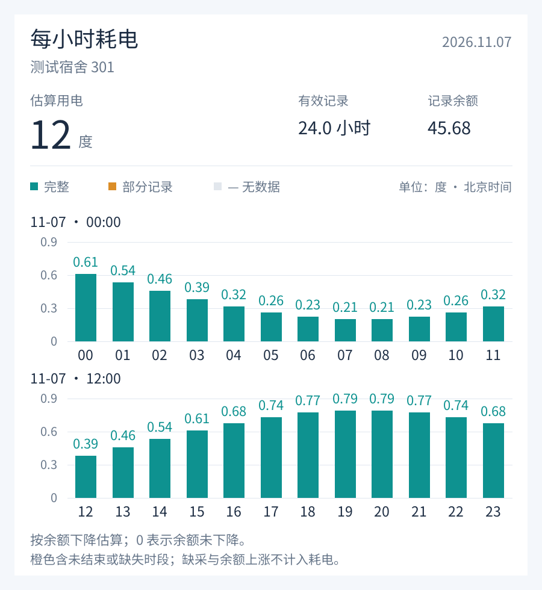
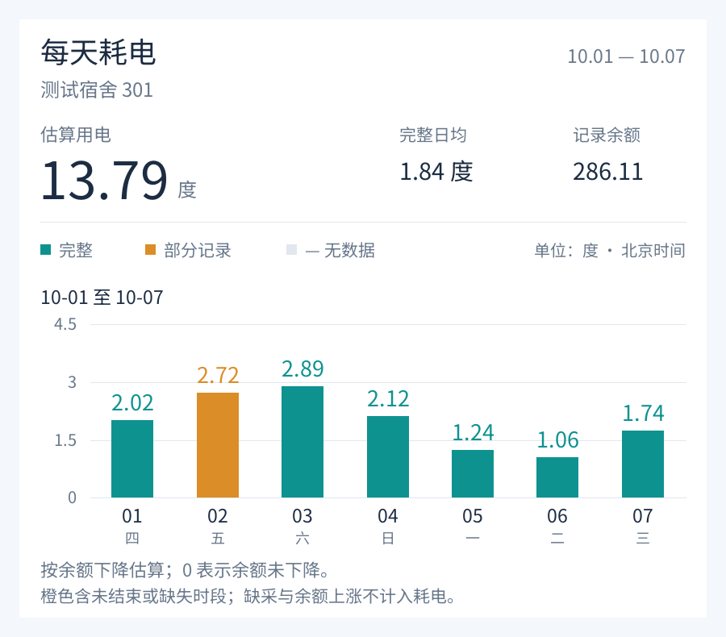

# 完美校园电费监控 Telegram Bot (WanXiao Elec Bot)

这是一个基于 Go 语言编写的 Telegram 机器人，用于查询完美校园（WanXiao）绑定的宿舍剩余电量，并支持低电量自动预警、每小时与每天的估算耗电统计。

> 💡 **珠海科技学院（学校代码 `1399`）** 的用户还可以直接在机器人中获取电费充值链接。


## 功能特性

*   **交互式菜单**：通过底部键盘和按钮进行操作，无需记忆复杂命令。
*   **多账号管理**：支持绑定和解绑多个完美校园账号。
*   **实时查询**：一键查询所有绑定账号的当前剩余电量。
*   **低电量预警**：后台定时监控电量，低于设定阈值时自动发送通知。
*   **获取充值链接**：支持 **珠海科技学院（学校代码 `1399`）**，选择金额后即可生成电费充值链接，点击跳转完成支付；预警消息中也可一键充值。
*   **用电统计**：一张图查看每小时或每天的耗电，支持切换日期、查看完整日均，并导出原始采样、小时统计和每日统计 CSV。
*   **统一采集**：所有绑定账号每小时 00、30 分自动检查，采集与预警共用查询；检查间隔固定为全局 30 分钟，用户不可修改。关闭预警仍会采集历史。
*   **个性化设置**：支持自定义预警阈值、开启/关闭预警。

## 快速开始

### 1. 获取 Bot Token
向 Telegram 的 [BotFather](https://t.me/BotFather) 申请一个新的 Bot，并获取 Token。

### 2. 配置
在程序运行目录下创建一个 `config.json` 文件（可参考 `config.json.example`），填入你的 Token：

```json
{
  "bot_token": "你的_TELEGRAM_BOT_TOKEN"
}
```

或者，你也可以设置环境变量 `BOT_TOKEN`。

### 3. 运行

#### 编译运行
确保你已安装 Go 环境。

```bash
# 初始化依赖
go mod tidy

# 编译
go build -o wanxiao-bot .

# 运行
# Windows
.\wanxiao-bot.exe

# Linux/Mac
./wanxiao-bot
```

## 使用指南

发送 `/start` 命令启动机器人，即可看到底部菜单栏：

*   **🔌 查询电量**：并发查询所有绑定宿舍的最新电量，结果中可一键 **🔄 刷新**；查询失败时会显示上次记录的余额。
*   **⚡ 充值电费**：选择金额（或自定义 1–500 元）后生成充值链接，点击 **💳 前往支付** 即可（目前仅支持珠海科技学院，学校代码 `1399`）。
*   **👤 账号管理**：
    *   查看已绑定的账号列表。
    *   点击 **➕ 添加账号**，输入学号后输入 **学校名称关键字** 搜索并点选学校（如 `郑州`、`珠海 科技`），或直接输入学校代码。
    *   也可以一次发送 `学号 学校代码` 或 `学号 学校名称`（例如 `2023123456 1399`、`2023123456 郑州大学`）。
    *   点击 **🗑 解绑** 并确认后删除该账号及历史记录；需要保留时请先导出 CSV。
*   **⚙️ 预警设置**：
    *   查看当前的报警阈值、开关状态和全局固定的 30 分钟检查间隔。
    *   **📉 修改阈值**：设置电量低于多少度时报警（可点选常用值或手动输入）。
    *   **🔔 开启 / 🔕 关闭预警**：新用户默认开启。
    *   余额跌破阈值时推送一次提醒，若持续偏低每 24 小时再提醒一次，余额恢复后自动重置。

*   **📊 用电统计**：默认用一张图显示今天每小时的估算耗电；绑定多个账号时先选择账号。
    *   点击 **每小时 / 每天** 在原消息中切换图表。每小时视图可翻到前一天、后一天或回到今天；每天视图可选近 7 天、近 30 天或本月。查看历史日期时切换视图，会保留所选日期。
    *   点击 **📅 选日期**，输入单日（如 `2026-11-05`）查看每小时耗电；输入起止日期（如 `2026-11-01 2026-11-05`）查看每天耗电，最多 31 天。
    *   点击 **更多** 查看统计说明、更新图表或导出 CSV。每天视图还可切到上月，或直接打开所选范围最后 7 个日期的小时图；多账号可在这里切换账号。
    *   CSV 分为原始采样、每小时统计、每天统计三个文件。查看和更新统计只读取本地记录。

常用命令：`/elec` 查询、`/recharge` 充值、`/accounts` 账号、`/settings` 设置、`/stats` 用电统计、`/cancel` 取消当前输入、`/help` 帮助。

统计图示例（演示数据）：

 

### 用电统计的口径

- 绑定成功、手动查询和全局每 30 分钟的后台查询，成功后都会记录实际采样时间和余额。失败不写入假余额；相同账号的后台请求按学校代码与账号去重，再分别保存到各用户的绑定。失败后仍在下一次全局检查重试。旧版本保存的个人检查间隔不再生效，旧按钮也不能修改间隔。
- 耗电根据相邻余额的下降估算，跨小时的正常采样区间按时间比例分摊。两次采样间隔超过 35 分钟时视为中断，不向小时栏位分摊。余额上涨视为疑似充值/调整，相关区间不计耗电，也不当作实际充值金额。采样间发生充值和用电、或上游余额延迟更新时，结果可能低估或归属到其他小时。
- 完整小时须为一个完整钟点区间、有效覆盖至少 59 分钟，且没有上涨或断采区间。每天耗电累计当天的有效小时估算，不补算缺失数据；完整日均只使用完整日期，当天和所选的部分日期不参与。完整日期须覆盖全天，允许最多一分钟的采样偏差，且没有上涨或断采区间。
- 未结束、缺采、充值等不完整时段用橙色提示；无有效数据用 `—` 表示，CSV 中耗电留空。读数未下降显示为 0，不代表实际没有用电；非零但小于 0.005 度的估算值显示为 `<0.01`。尚未到达的小时标为“未到”。
- 当连续记录反复出现整度下降与不变读数时，提示“整度阶梯变化”：这些记录不能精确定位真实用电发生的小时。缺采区间已知的余额下降单独提示，不分配到小时或每日累计。
- 旧缓存缺少电表类型时，只在同一房间的已知类型唯一的情况下归并；原始 CSV 保留原标识。
- 所有日期和小时按北京时间显示和分组。更换房间/电表后不跨表相减；统计图使用所选范围最后观测到的电表，原始 CSV 保留范围内全部采样，供核对换房前后的记录。
- 历史数据保存在原来的 `wanxiao.db` 中，升级会自动新增表，只将已知的最后一次余额按原时间作为起始记录，重复启动不会重复导入。更早记录无法凭空补回。默认长期保留，解绑时同时删除该绑定的历史。停止机器人后备份整个数据库即可保留历史。

## 技术栈

*   **Go** (Golang)
*   **Telebot v3**: Telegram Bot API 框架
*   **GORM**: ORM 库 (使用 SQLite 存储数据)
*   **Cron v3**: 定时任务调度
*   **golang.org/x/image**: 本地图表绘制，内嵌 Noto Sans SC 中文字体，无需系统字体或外部图表服务。字体遵循 [SIL OFL 1.1](charts/fonts/OFL.txt)，与项目的 MIT 代码许可分别适用。

## 验证

```bash
go test ./...
go test -race ./...
CGO_ENABLED=0 GOOS=linux GOARCH=amd64 go build -o /tmp/wanxiao-bot-linux-amd64 .
CGO_ENABLED=0 GOOS=windows GOARCH=amd64 go build -o /tmp/wanxiao-bot-windows-amd64.exe .
```

测试覆盖旧数据库升级、采集与预警分离、共享查询去重、余额校验、整点插值、每日汇总、充值/断采/换房处理、数据隔离、CSV、中文图表和图表切换。

## 注意事项

*   本程序仅用于学习交流，请勿用于非法用途。
*   API 来源于对完美校园 App 的抓包分析，可能会随官方更新而失效。
*   `customercode` (客户代码) 是学校在完美校园系统中的唯一标识。仓库内置了完整的学校代码列表 [`schools/schools.csv`](schools/schools.csv)（约 2900 所），绑定时可直接按名称搜索；列表中没有的学校也可以手动输入代码。

## License

MIT
